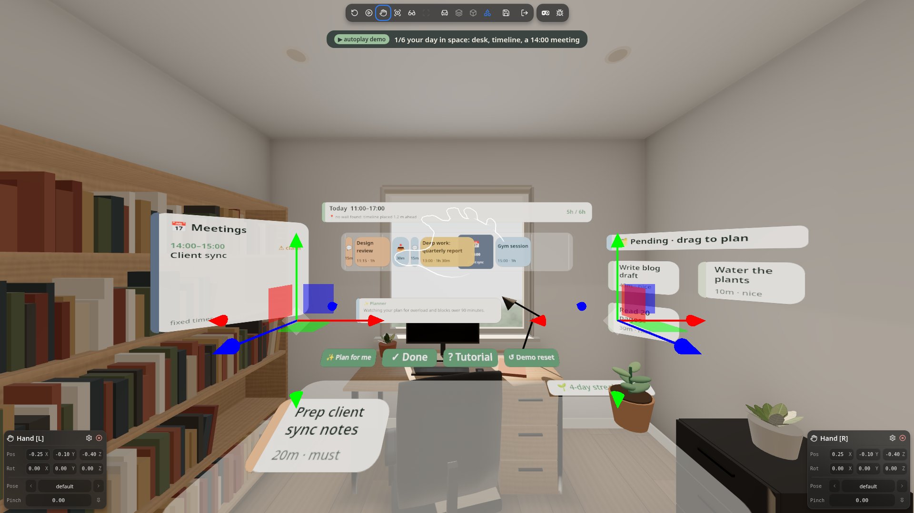
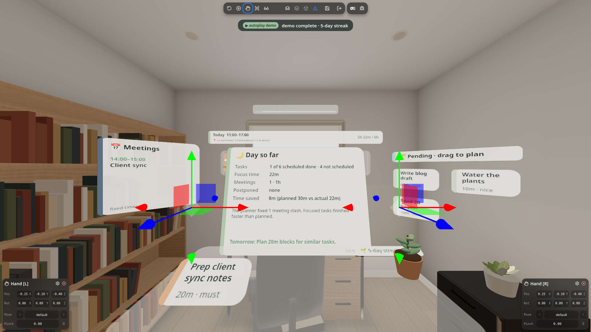

# Morning Desk

**Plan, focus, adapt and measure your day with your hands.** Morning Desk is a mixed-reality day planner for Meta Quest 3: your tasks sit on the desk in front of you, your day hangs on your real wall, a focus mode helps you do one thing at a time, and a rule-based smart planner keeps the schedule realistic as the day changes.

[](https://muditsharma354abc-bot.github.io/morning-desk/)
[](LICENSE)
[](https://github.com/facebook/immersive-web-sdk)

Built for the Start Developer Competition (Productivity track, New Experience division).

| Link | What you get |
| --- | --- |
| [Live app](https://muditsharma354abc-bot.github.io/morning-desk/) | Your own plan, saved on this device. The hands tutorial starts on your first visit. |
| [Demo state](https://muditsharma354abc-bot.github.io/morning-desk/?demo=1) | A fixed sample day with a 14:00 Client sync and a 90-minute deep-work block that runs into it, so the planner has something to fix. It uses separate storage and never touches your real plan. |
| [Autoplay demo](https://muditsharma354abc-bot.github.io/morning-desk/?demo=1&autoplay=1) | A hands-free walkthrough of about a minute that drives the real app through emulated hands, with captions. It needs a desktop browser (it uses the built-in emulator). |

On a Quest 3, open the live app in the Meta Quest Browser and press **Enter XR**. On a desktop browser the built-in emulator runs it, no headset or extension needed.



## Plan, Focus, Adapt, Measure

1. **Plan.** Pinch a task card off the desk and drop it on the wall timeline. Fixed meetings are part of the day, and any block that runs into one is flagged.
2. **Focus.** A quick pinch on a task opens Focus Mode with a 25 or 50 minute timer.
3. **Adapt.** When a focus block ends early or late, later blocks shift by the measured time, and the smart planner re-checks the day for meeting clashes and overload.
4. **Measure.** The day summary reports only what was actually measured.

## The spatial layout

Everything is placed for a seated user, with key UI close to the centre of view.

- **In front:** the wall timeline, and the Focus panel when you're focusing.
- **Left:** the meetings board. A meeting that a scheduled block runs into shows a **⚠ clash** warning.
- **Right:** the pending board with tasks you haven't planned yet ("drag to plan").
- **On the desk:** must-do task cards within reach, plus the **✨ Plan for me**, **✓ Done**, **? Tutorial** and **↺ Demo reset** buttons.
- **Behind the timeline:** a completed strip showing how many tasks are done.

## Focus Mode

- **Quick pinch (tap)** a task card to open a big Focus panel in front of you. The timer starts at 25 minutes; switch to **50 min** with a button.
- While you focus, the other tasks fade and the passthrough view dims around you.
- **Thumbs-up** (or **✓ Done**) finishes the task, early if you like. **✕ Exit** leaves without finishing.
- When the timer runs out, the panel asks **Done or more time?** Thumbs-up means done; a pinch (or **+15 min**) adds 15 minutes.
- In the demo state the timer is accelerated so a full block fits in a video, and the panel says so: **⏩ Demo: 1 s = 2 min (accelerated)**. Outside the demo it runs in real time.


## The smart planner

Tap **✨ Plan for me** and the planner proposes one concrete change at a time. Each change animates into place and waits for your decision: thumbs-up keeps it, thumbs-down undoes it and restores the exact previous plan. **👍 Keep** and **👎 Undo** buttons are there as a fallback.

It checks, in this order:

1. **Meeting clash.** In the demo, "Deep work: quarterly report" (90 min) starts at 13:00 and runs into the 14:00 Client sync, leaving only 60 minutes. The fix splits it: 60 minutes before the meeting, the remaining 30 minutes after it. If the free gap is under 15 minutes, the block moves after the meeting instead.
2. **Long blocks.** Any block longer than 90 minutes is split into focus blocks of 90 minutes or less, with another task between the parts so you get a break.
3. **Overload.** If the day runs past your free time, it says by how much and moves a low-priority block to a **Tomorrow** row.

After a focus block, later blocks shift by the measured time (for example, "done 8m early, later blocks moved 8m earlier"), and the planner runs these checks again.

The planner is rule-based and runs entirely on the device: there's no AI model, no API key and no network call. It sits behind a small `Planner` interface in `src/planner.ts`.


## The day summary

Press **✓ Done** on the desk to close the day. Your streak goes up (if you also finished yesterday) and the desk plant grows. A **Day so far** panel shows:

- **Tasks:** done out of today's scheduled tasks, for example "1 of 6 scheduled done". A split task counts once, and unscheduled tasks are listed separately ("4 not scheduled").
- **Focus time:** the focus minutes actually measured by the timer.
- **Meetings:** how many and how long.
- **Postponed:** tasks moved to tomorrow.
- **Time saved** (or **Over plan**): shown only when there are measured focus blocks, always with the baseline next to it, for example "8m (planned 30m vs actual 22m)".

It ends with a short rule-based note on why the day went that way and one suggestion for tomorrow.



## Hands-only interactions

Everything works with bare hands (controllers and mouse work too).

| Gesture | What happens |
| --- | --- |
| **Pinch-grab** a card | Picks it up. |
| **Drop on the wall timeline** | Aim the card at the timeline and open your fingers. It's placed along the head-to-card ray, so you don't have to reach the wall from your chair. |
| **Flick sideways** | Skips the card for today. |
| **Quick pinch (tap)** | Opens Focus Mode for that task. |
| **Thumbs-up / thumbs-down** | Keeps or undoes the planner's change, and thumbs-up finishes a focus block. Hold it for about half a second. |
| **Fingertip poke** | Presses buttons. |

The **hands tutorial** starts on your first visit and moves on only when you actually do each gesture. Replay it with **? Tutorial**, or add `?tutorial=1` to the URL.

## Trying it in the emulator

The autoplay demo selects the emulator's hands mode by itself. To pinch by hand on a desktop instead, outside the emulator's play mode:

1. Open the [demo state](https://muditsharma354abc-bot.github.io/morning-desk/?demo=1) in a desktop browser and press **Enter XR**.
2. In the emulator toolbar at the top, switch the input to **Hands** mode.
3. Use the emulator's **Pinch** latch to hold a pinch on a hand, move that hand to drag a card, then release the latch to drop it.

## What's tested and what isn't

- Everything has been run in the built-in WebXR emulator (IWER) only. Nothing has been tested on a real Quest 3 yet, so wall detection, anchors, hand tracking and performance on the headset are unverified.
- Manual pinch through the emulator's pinch latch has been verified by script, but not yet by a person dragging by hand.
- Ray pinch on far timeline blocks is untested.
- Voice input is not built.

## Wall anchor and fallback

In XR the app uses plane detection to find a vertical wall in front of you within comfortable seated viewing distance and pins the timeline there with a WebXR anchor. The pose is saved against IWSDK's persistent anchor, so the timeline can come back on the same wall next session.

If no suitable wall is found (or the browser has no plane detection), the timeline is placed **1.1 m in front of you at eye height**, and the header says it's using the fallback.

## Run it locally

You need Node.js 20.19+, 22.12+ or 24+.

```bash
npm ci
npm run dev
```

`npm run dev` starts the managed IWSDK dev server and opens the app with the **built-in WebXR emulator (IWER)**, so you can enter XR on a desktop with emulated hands. In the flat view, the mouse drags cards and clicks buttons.

To try it on a **Quest 3**, the simplest path is the [live site](https://muditsharma354abc-bot.github.io/morning-desk/) in the Meta Quest Browser, then press **Enter XR**. For a local build on the headset, serve it over HTTPS (WebXR needs a secure context) or forward the dev port with `adb reverse`.

Other scripts: `npm run build` (production build to `dist/`), `npm run preview`, `npm run typecheck`.

## Deploy

```bash
scripts/deploy-pages.sh
```

It builds with the `/morning-desk/` base path and publishes `dist/` to the `gh-pages` branch, which GitHub Pages serves at <https://muditsharma354abc-bot.github.io/morning-desk/> about a minute later. Set `VITE_BASE=./` for a build that works from any folder.

## Tech stack

- [IWSDK](https://github.com/facebook/immersive-web-sdk) (`@iwsdk/core`) for the ECS world, hand grab, poke and ray interaction, plane detection and anchors, and the IWER emulator
- [three.js](https://threejs.org/) for rendering
- [pmndrs uikit](https://github.com/pmndrs/uikit) (`@pmndrs/uikit`, Horizon kit) for spatial UI
- [WebXR](https://immersive-web.github.io/webxr/) with passthrough (immersive AR) and hand tracking
- TypeScript and Vite

```
src/
  desk-system.ts   desk, wall timeline, boards, gestures, Focus Mode, summary, tutorial, streak and plant
  planner.ts       Planner interface + RulePlanner (meeting clash, long-block split, overload)
  state.ts         plan state, demo day with meetings, layout around meetings, local storage, streak
  autoplay.ts      ?demo=1&autoplay=1 walkthrough through emulated hands
  label.ts, style.ts   canvas labels, palette, sounds
```

## License

[MIT](LICENSE) © 2026 Shubham Sharma
