# Morning Desk

**Plan, focus, adapt and measure your day with your hands.** Morning Desk is a mixed-reality day planner for Meta Quest 3: your tasks sit on the desk in front of you, your day hangs on the wall in front of you, a focus mode helps you do one thing at a time, and the planner keeps the schedule realistic as the day changes. The planner is an on-device planning agent: rule-based, no API key, no network calls (the app only loads its own bundled files).

[](https://muditsharma354abc-bot.github.io/morning-desk/)
[](LICENSE)
[](https://github.com/facebook/immersive-web-sdk)

Built for the Start Developer Competition (Productivity track, New Experience division).

| Link | What you get |
| --- | --- |
| [Live app](https://muditsharma354abc-bot.github.io/morning-desk/) | Your own plan, saved on this device. The hands tutorial starts on your first visit. |
| [Demo state](https://muditsharma354abc-bot.github.io/morning-desk/?demo=1) | A fixed sample day with a 14:00 Client sync and a 90-minute deep-work block that runs into it, so the planner has something to fix. It uses separate storage and never touches your real plan. |
| [Autoplay demo](https://muditsharma354abc-bot.github.io/morning-desk/?demo=1&autoplay=1) | A hands-free walkthrough of about 2–3 minutes that drives the real app through emulated hands, with captions. It needs a desktop browser (it uses the built-in emulator). |
| [v2 hands-only autoplay](https://muditsharma354abc-bot.github.io/morning-desk/?demo=1&autoplay=1&mr=1&hands=1) | The v2 walkthrough driven by emulated hands only, no controller at any step. |
| [Morning autoplay](https://muditsharma354abc-bot.github.io/morning-desk/?demo=1&autoplay=1&mr=1&hands=1&clean=1&wake=1&mood=okay) | The v2 hands-only walkthrough that starts with Room wakes up, then picks the Okay mood and keeps the morning plan (`&mood=low` or `&mood=focused` to change it). |
| [v2 MR autoplay](https://muditsharma354abc-bot.github.io/morning-desk/?demo=1&autoplay=1&mr=1) | About 2 minutes in the emulator's simulated room: desk and timeline placed on the room's table and wall, the same spot after re-entering XR, Re-place, one focus block, and Wind-down. |

On a Quest 3, open the live app in the Meta Quest Browser and press **Enter XR**. On a desktop browser the built-in emulator runs it, no headset or extension needed.

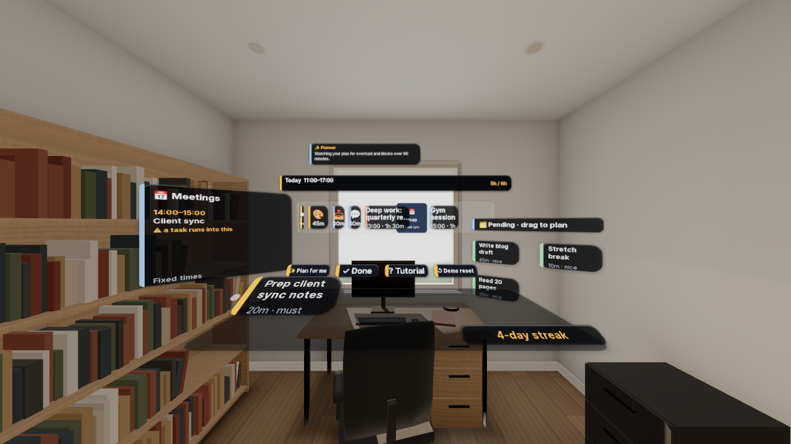

## Plan, Focus, Adapt, Measure

1. **Plan.** Pinch a task card off the desk and drop it on the timeline. Fixed meetings are part of the day, and any block that runs into one is flagged.
2. **Focus.** A quick pinch on a task opens Focus Mode with a 25 or 50 minute timer.
3. **Adapt.** When a focus block ends early or late, later blocks shift by the measured time, and the smart planner re-checks the day for meeting clashes and overload.
4. **Measure.** The day summary reports only what was actually measured.
5. **Wind down.** In the evening, **🌙 Wind down** recaps what got done, lets you keep or drop each unfinished task, and starts tomorrow's timeline with the ones you kept.

## The spatial layout

Everything is placed for a seated user, with key UI close to the centre of view.

- **In front:** the wall timeline, and the Focus panel when you're focusing.
- **Left:** the meetings board. A meeting that a scheduled block runs into shows a **⚠ clash** warning.
- **Right:** the pending board with tasks you haven't planned yet ("drag to plan").
- **On the desk:** must-do task cards within reach, plus the **✨ Plan for me**, **✓ Done**, **? Tutorial** and **↺ Demo reset** buttons.
- **Behind the timeline:** a completed strip showing how many tasks are done.

## Focus Mode

- **Quick pinch (tap)** a task card to open a big Focus panel in front of you. The timer starts at 25 minutes; switch to **50 min** with a button.
- While you focus, the other tasks fade and the passthrough view dims around you.
- **Thumbs-up** (or **✓ Done**) finishes the task, early if you like. **✕ Exit** leaves without finishing.
- When the timer runs out, the panel asks **Done or more time?** Thumbs-up means done; a pinch (or **+15 min**) adds 15 minutes.
- In the demo state the timer is accelerated so a full block fits in a video, and the panel says so: **⏩ Demo: 1 s = 2 min (accelerated)**. Outside the demo it runs in real time.

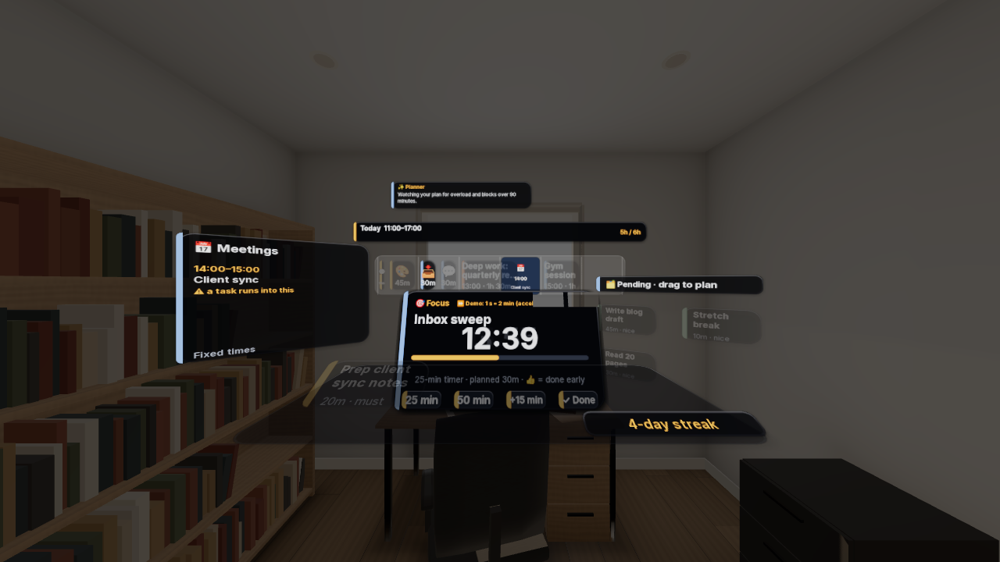

## Room wakes up, Mood check and Morning agent (steps 1–3)

These run in the MR flow (`?mr=1` in the emulator, automatic on a headset). All three are **tested in the emulator only**; none has been tried on a Quest 3 yet.

### Room wakes up

Once per XR session, after the desk and timeline are placed, the room wakes up in about 9 seconds: the room dims and turns warm, a sunrise glow rises behind the timeline, a light beam draws the timeline in, the task cards appear one by one with a soft chime (all of them within about 5 seconds), and an original desk buddy opens its eyes. The buddy has four expressions (asleep, awake, sleepy, happy) and reacts to your mood and to planner changes. A pinch or poke skips the wake-up. It never runs in autoplay or with `?clean=1`, and `&wake=0` turns it off; in autoplay, `&wake=1` forces it to play once at the start.

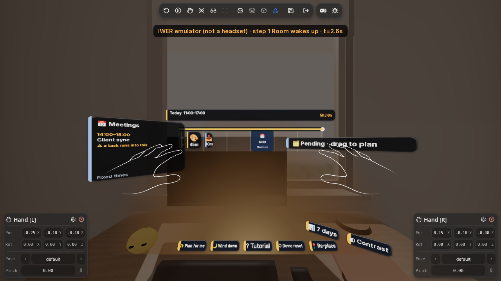

### Mood check

Right after the wake-up, the panel asks **How do you feel today?** with three orbs you pick by poke or pinch. The mood sets the longest focus block and the break after each block:

| Mood | Longest block | Break between blocks |
| --- | --- | --- |
| **Low** | 20 min | 10 min |
| **Okay** | 45 min | 5 min |
| **Focused** | 90 min | none |

On a Low day the morning plan keeps at most 5 open blocks (one extra must-do can be added); the rest wait in Pending. The mood is saved on this device only, and it's asked once a day. In autoplay with `&wake=1`, the mood is picked automatically: Okay by default, or `&mood=low|okay|focused`.

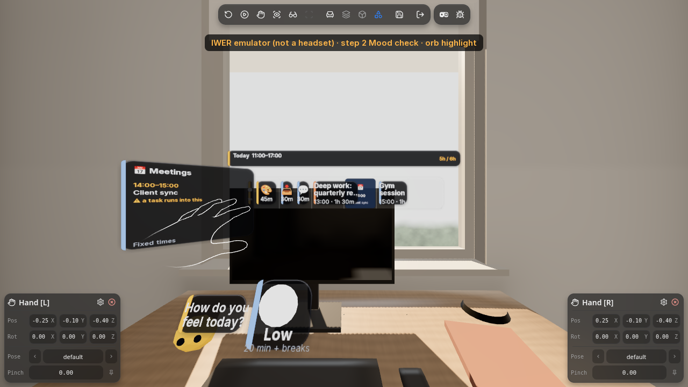

### Morning agent

Once a day, after the mood check, the planner (the same rules as above) makes one morning plan from yesterday's leftovers, today's meetings and your mood: meeting clashes first, then mood splits, the Low-day cap, overload moved to tomorrow, and must-dos from the desk that fit. Cards fly to their new places, and it shows **one** line, for example *"Okay mood. Moved 5 things for you: 1 must-do planned, 1 clash fixed, 2 split, 1 to tomorrow"*, with **👍 Keep** / **👎 Undo** by thumbs or button. Undo keeps your mood and puts the plan back. If nothing needs to move, it says so.

During the day it adjusts quietly, with no panel or popup: if a meeting clash appears it fixes it, and if you finish a block early it fills the freed time with a Pending task that fits. The moved cards nudge and the buddy reacts. In the evening (once your planned time is over), **🌙 Wind down** opens by itself once that day with a cool blue tint, and the tasks you keep roll over into tomorrow's plan. In the demo the evening only starts with `?evening=1`. In autoplay the morning plan runs once, without quiet adjusts or the automatic Wind down.

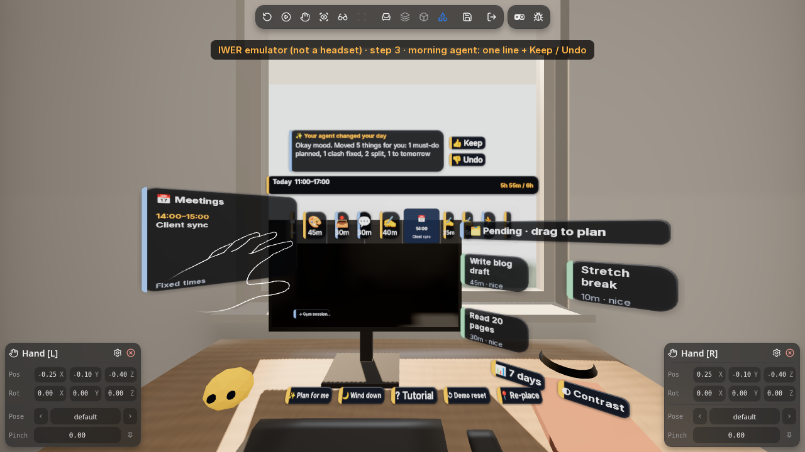

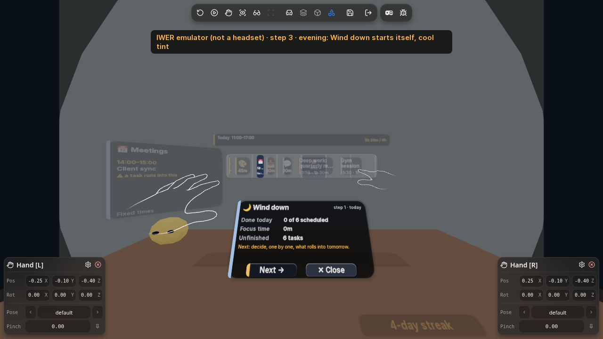

## The smart planner

Tap **✨ Plan for me** and the planner proposes one concrete change at a time. Each change animates into place and waits for your decision: thumbs-up keeps it, thumbs-down undoes it and restores the exact previous plan. **👍 Keep** and **👎 Undo** buttons are there as a fallback.

It checks, in this order:

1. **Meeting clash.** In the demo, "Deep work: quarterly report" (90 min) runs into the 14:00 Client sync. The planner splits it around the meeting: the first part fills the free time before 14:00, and the rest goes straight after the meeting. The meeting stays put and the full 90 minutes still fit. How the split falls depends on when the block starts. If the free gap before the meeting is under 15 minutes, the whole block moves after the meeting instead. A thumbs-up keeps the fix.
2. **Long blocks.** Any block longer than 90 minutes is split into focus blocks of 90 minutes or less, with another task between the parts so you get a break.
3. **Overload.** If the day runs past your free time, it says by how much and moves a low-priority block to a **Tomorrow** row.

After a focus block, later blocks shift by the measured time (for example, "done 8m early, later blocks moved 8m earlier"), and the planner runs these checks again.

The planner is an on-device planning agent: rule-based, no API key, no network calls (the app only loads its own bundled files). It sits behind a small `Planner` interface in `src/planner.ts`.

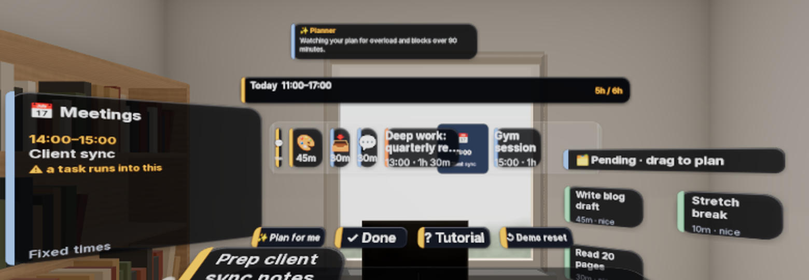

## The day summary

Press **✓ Done** on the desk to close the day. Your streak goes up if you also finished yesterday. It's a plain day count, with no other rewards. A **Day so far** panel shows:

- **Tasks:** done out of today's scheduled tasks, for example "4 of 6 scheduled done". A split task counts once, and unscheduled tasks are listed separately ("4 not scheduled").
- **Focus time:** the focus minutes actually measured by the timer.
- **Meetings:** how many and how long.
- **Postponed:** tasks moved to tomorrow.
- **Time saved** (or **Over plan**): shown only when there are measured focus blocks, always with the baseline next to it, for example "8m (planned 30m vs actual 22m)". In demo mode the clock runs fast, so this row is labelled "(demo clock, accelerated)".

It ends with a short rule-based note on why the day went that way and one suggestion for tomorrow.

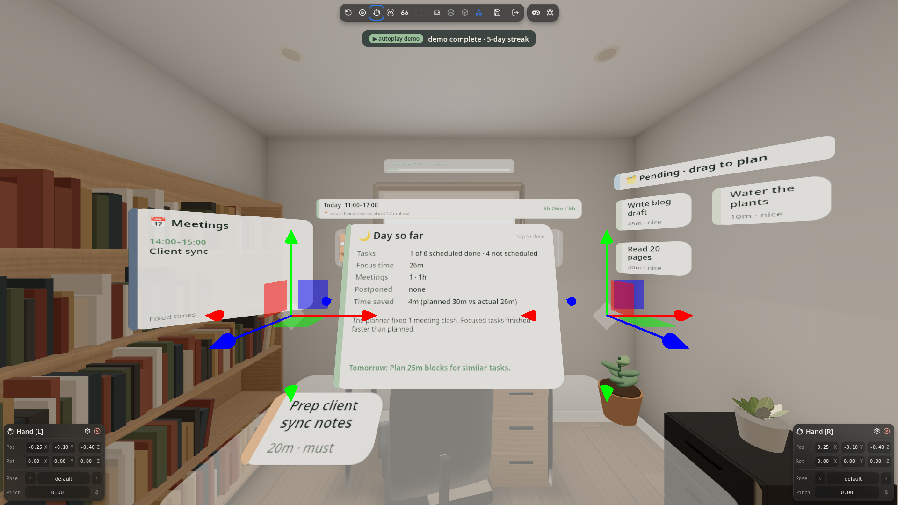

## Hands-only interactions

Hands are the default input everywhere, including the emulator (controllers and mouse work too; add `?controllers=1` to use emulated controllers).

| Gesture | What happens |
| --- | --- |
| **Pinch-grab** a card | Picks it up. |
| **Drop on the wall timeline** | Aim the card at the timeline and open your fingers. It's placed along the head-to-card ray, so you don't have to reach the wall from your chair. |
| **Flick sideways** | Skips the card for today. |
| **Quick pinch (tap)** | Opens Focus Mode for that task. |
| **Thumbs-up / thumbs-down** | Keeps or undoes the planner's change, and thumbs-up finishes a focus block. Hold it for about half a second. |
| **Fingertip poke** | Presses buttons. |
| **Pinch or poke during Room wakes up** | Skips the wake-up. |
| **Poke or pinch a mood orb** | Picks Low, Okay or Focused. |

Every gesture has a button alternative, and in hands mode every button can be pressed by fingertip poke or by pinching along the hand ray (tested in the emulator):

| Gesture | Button alternative |
| --- | --- |
| Pinch-drag a card to the timeline | **📅 Plan it** |
| Flick sideways | **⏭ Skip** |
| Thumbs-up / thumbs-down on a planner change or the morning plan | **👍 Keep** / **👎 Undo** |
| Thumbs-up in Focus Mode | **✓ Done** (plus **+15 min** and **✕ Exit**) |
| Thumbs-up / thumbs-down in Wind-down | **→ Tomorrow** / **✕ Drop** |

Other buttons: **📍 Re-place**, **◐ Contrast** and **📊 7 days**. One open point: **→ Tomorrow** by poke has only been confirmed in the scripted run so far.

The **hands tutorial** starts on your first visit and moves on only when you actually do each gesture. Replay it with **? Tutorial**, or add `?tutorial=1` to the URL.

## Trying it in the emulator

The autoplay demo selects the emulator's hands mode by itself. To pinch by hand on a desktop instead, outside the emulator's play mode:

1. Open [?demo=1](https://muditsharma354abc-bot.github.io/morning-desk/?demo=1) and click **Enter MR**. The emulator starts in hands mode; both hand panels should say hand.
2. Drag the right hand's arrows onto a card.
3. Click the **Pinch** latch (pin icon) in the right hand panel to grab it.
4. Drag the hand to the timeline.
5. Click the latch again to drop it.

## What's tested and what isn't

- Everything has been run in the built-in WebXR emulator (IWER) and its simulated room only. Nothing has been tested on a real Quest 3 yet.
- **Needs a headset to verify:** how real passthrough looks and feels, whether cards read well on a real desk, plane detection and hit-test in real rooms, anchors surviving real sessions, reboots and space changes, real-world reach and comfort (seated or standing), real hand tracking for pinch, poke and thumbs, Room wakes up (glow, beam, buddy) on a real wall, the mood orbs, the morning agent, quiet adjusts and the automatic evening Wind down, and the VR fallback on a device without immersive-ar.
- Manual pinch through the emulator's pinch latch has been verified by script, but not yet by a person dragging by hand.
- Ray pinch on far timeline blocks is untested on a headset.
- **Not yet tested on a headset:** frame rate (no fps figure is claimed anywhere), real placement on a real desk and wall, anchors coming back after a reload, and **→ Tomorrow** by poke.
- Room wakes up, Mood check and the Morning agent (steps 1–3) are tested in the emulator only.
- The [headset test plan](docs/HEADSET_TEST_PLAN.md) lists the Quest 3 session that will check these.

## Mixed reality: desk, wall and anchors (v2)

Placement uses standard WebXR plane detection, hit-test and anchors through IWSDK (not MRUK). In the emulator, `?mr=1` places the timeline on the detected wall of the simulated room, and Re-place works. On a headset the app starts an immersive-ar passthrough session, so the planner sits in your real room.

- **Desk:** it looks for a table-height surface first, then tries a hit-test, and if both fail it asks you to tap to place the desk about 60 cm ahead.
- **Timeline:** it goes on a detected wall in front of you. If no wall is found, it floats about 1.1 m ahead at eye height.
- **Same spot when you return:** the desk and wall are saved against a persistent WebXR anchor, so the desk comes back in the same spot (tested in the emulator only; untested on a headset). If the anchor can't be found, you place them again.
- **Room Zones (step 4):** tap 🎯 Claim zone, look to target a real surface (head gaze), then pinch to claim it. The first claim is a Focus zone and the second a Quick zone. The planning agent sends long Pending cards to Focus and short ones to Quick, and you can drop a card on a zone yourself. Zones are stored relative to the anchored desk, so they come back in the same spot (tested in the emulator only; untested on a headset).
- **Look to target:** the card you face for half a second glows. This is head gaze, not eye tracking.
- **Depth occlusion:** always requested, with no flag needed. If depth sensing isn't granted, the app logs one line and renders normally. Real occlusion only works on a headset and is unverified on Quest 3S.

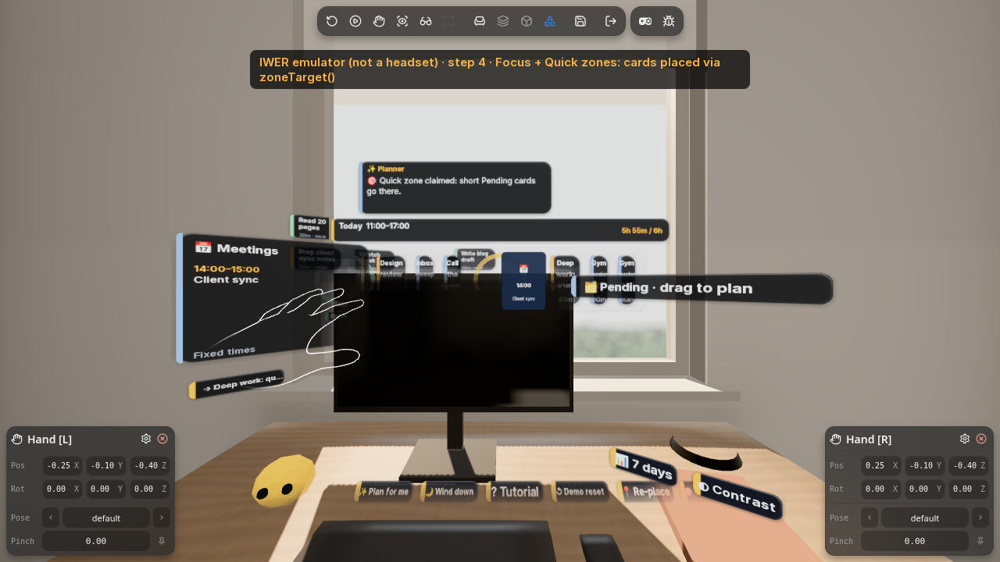

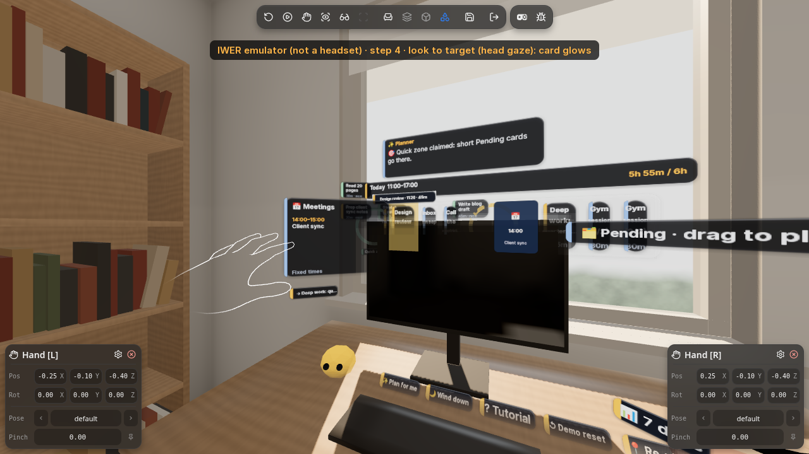
- **📍 Re-place** on the desk moves everything to where you're sitting now.
- **VR fallback:** if the browser can't do immersive-ar, you get a virtual room instead.

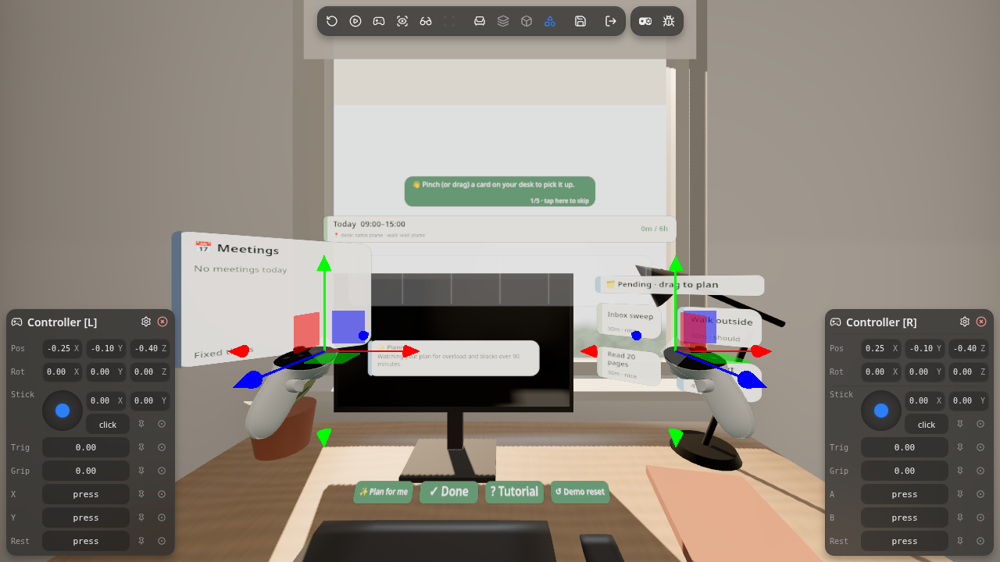

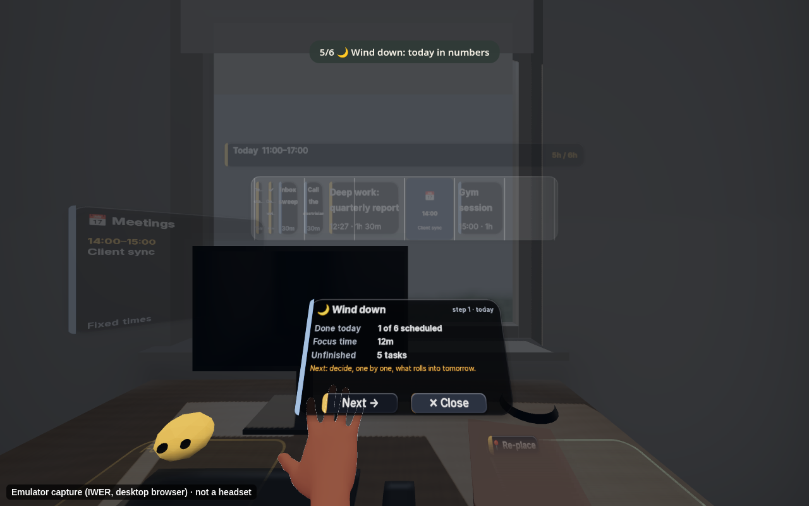

## Accessibility, progress and testing

- **High contrast:** the **◐ Contrast** button (or `?contrast=1`) switches to a high-contrast palette.
- **Last 7 days:** **📊 7 days** shows your progress over the past week, built only from data saved locally on this device. A fresh start shows **Start your streak today**. A **Sample week (demo data)** toggle fills the view with example days so you can see how it looks; it's off by default, held in memory only, and never mixed with or saved to your real history.
- **Demo isolation:** demo runs use separate `morning-desk.demo.*` storage, so your real history and anchors stay untouched. Both demo walkthroughs end on **5-day streak (sample demo week)**, and Wind down closes at the end.
- **Readability:** timeline text is 1.5x larger, and the flat (non-XR) view fits common Mac screen sizes.
- **Headset checklist:** `?test=1` adds a 16-item checklist you tick by poke, with a live frame-rate readout (average and minimum over the last 10 seconds). In the desktop emulator the scene is rendered in software, so that number is not a Quest frame rate. See [docs/HEADSET_TEST_PLAN.md](docs/HEADSET_TEST_PLAN.md).

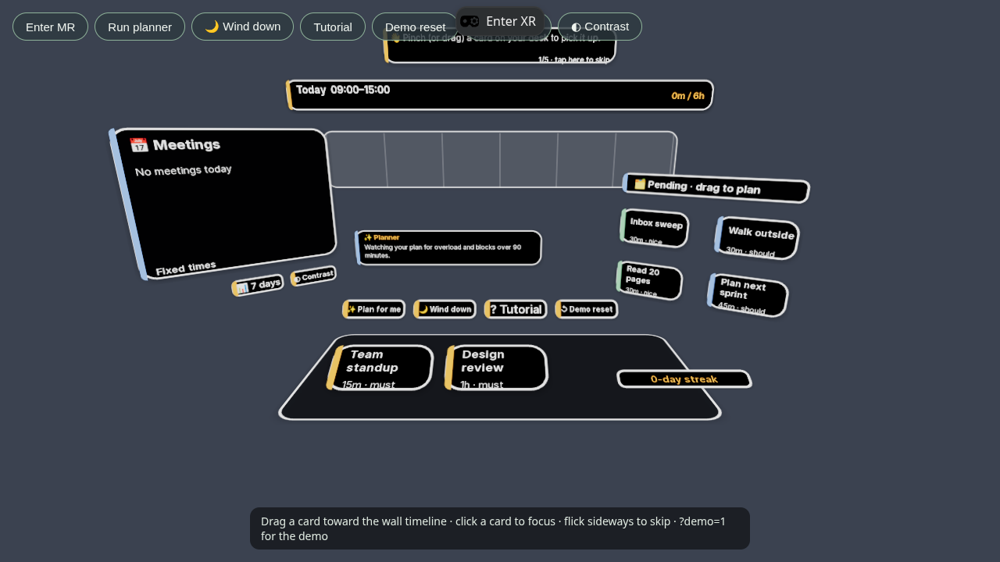

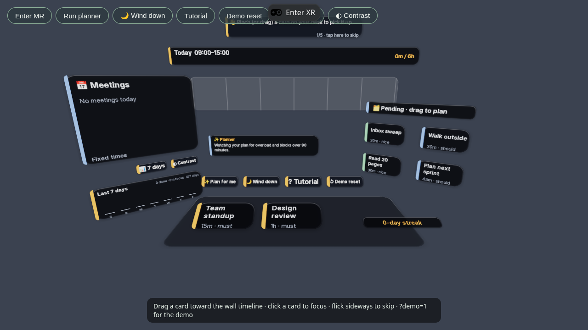

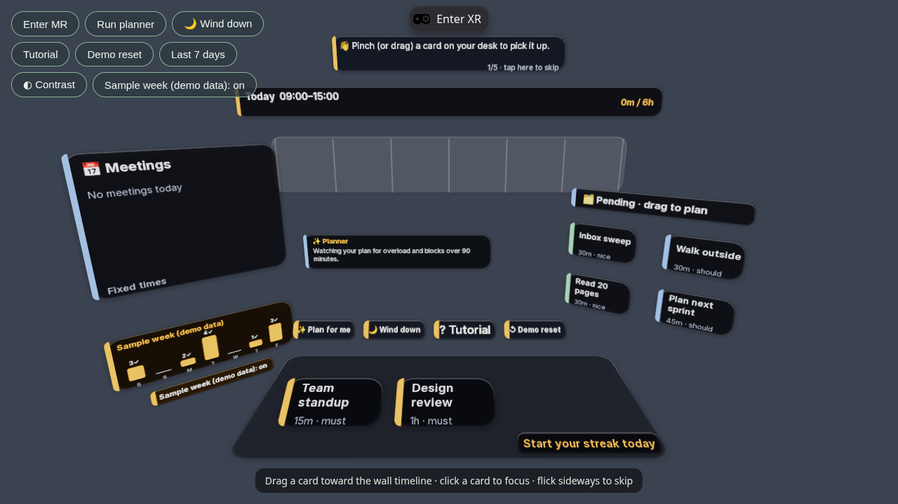

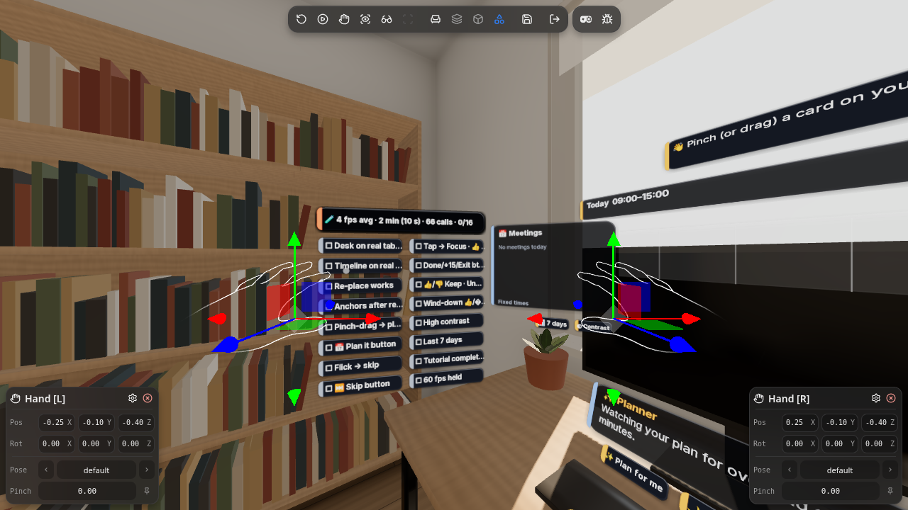

## Look and sound

- A dark glass palette, with the [Inter](https://github.com/rsms/inter) typeface bundled locally (SIL Open Font License).
- Short sounds for pinch, drop, timer start and thumbs-up, synthesized by our own script (`scripts/make-sfx.mjs`) and released as CC0, in `public/sfx`.
- Picked-up cards scale up slightly, and dropped cards snap into place with a small bounce.
- Full attributions are in [CREDITS.md](CREDITS.md).

Close-up distances: cards sit within reach (about 60 cm), the Focus and summary panels open about 0.6 m in front of you, and a task's detail card about 0.7 m. Key UI stays within about ±30° of the centre of view.

### URL flags

- `?mr=1` runs the MR flow in the emulator, seated at the simulated room's desk. Real headsets use it automatically.
- `?demo=1&autoplay=1&mr=1` is the v2 walkthrough. `?demo=1&autoplay=1&clean=1` is the original walkthrough, unchanged.
- `?tutorial=1` restarts the tutorial on a fresh sample desk, and `?hands=1` makes the autoplay walkthrough use hands only (`?demo=1&autoplay=1&mr=1&hands=1`). Hands are already the default everywhere else.
- `?contrast=1` starts in high contrast, and `?test=1` shows the headset test checklist.
- `?controllers=1` switches the emulator to controllers instead of hands, and `?gizmos=1` shows the emulator's move gizmos (both hidden by default).
- `&wake=0` turns Room wakes up off. In autoplay, `&wake=1` plays it once at the start and then picks the mood automatically, with `&mood=low|okay|focused` (default Okay): `?demo=1&autoplay=1&mr=1&hands=1&clean=1&wake=1&mood=okay`.
- `?evening=1` treats it as evening, so Wind down can open by itself (needed in the demo).
- `?debug=1` shows placement and anchor status on the timeline header.
- Test flags: `?vr=1` (as if immersive-ar weren't supported), `?noplanes=1` (forces tap to place) and `?nextday=1` (pretends it's tomorrow, to check the wind-down rollover).

## Run it locally

You need Node.js 20.19+, 22.12+ or 24+.

```bash
npm ci
npm run dev
```

`npm run dev` starts the managed IWSDK dev server and opens the app with the **built-in WebXR emulator (IWER)**, so you can enter XR on a desktop with emulated hands. In the flat view, the mouse drags cards and clicks buttons.

To try it on a **Quest 3**, the simplest path is the [live site](https://muditsharma354abc-bot.github.io/morning-desk/) in the Meta Quest Browser, then press **Enter XR**. For a local build on the headset, serve it over HTTPS (WebXR needs a secure context) or forward the dev port with `adb reverse`.

Other scripts: `npm run build` (production build to `dist/`), `npm run preview`, `npm run typecheck`.

## Deploy

```bash
scripts/deploy-pages.sh
```

It builds with the `/morning-desk/` base path and publishes `dist/` to the `gh-pages` branch, which GitHub Pages serves at <https://muditsharma354abc-bot.github.io/morning-desk/> about a minute later. Set `VITE_BASE=./` for a build that works from any folder.

## Tech stack

- [IWSDK](https://github.com/facebook/immersive-web-sdk) (`@iwsdk/core` pinned at exactly `1.1.0-rc.2`) for the ECS world, hand grab, poke and ray interaction, plane detection and anchors, and the IWER emulator
- [three.js](https://threejs.org/) for rendering
- [pmndrs uikit](https://github.com/pmndrs/uikit) (`@pmndrs/uikit`, Horizon kit) for spatial UI
- [WebXR](https://immersive-web.github.io/webxr/) with passthrough (immersive AR) and hand tracking
- TypeScript and Vite

```
src/
  desk-system.ts   desk, wall timeline, boards, gestures, Focus Mode, summary, tutorial, wind-down, streak
  planner.ts       Planner interface + RulePlanner (meeting clash, long-block split, overload, morning plan)
  state.ts         plan state, demo day with meetings, layout around meetings, local storage, streak
  autoplay.ts      ?demo=1&autoplay=1 walkthrough through emulated hands
  autoplay-v2.ts   ?demo=1&autoplay=1&mr=1 walkthrough (placement, Re-place, wind-down)
  wake.ts          Room wakes up, desk buddy, mood orbs
  label.ts, style.ts   canvas labels, palette, sounds
```

## License

[MIT](LICENSE) © 2026 Shubham Sharma
