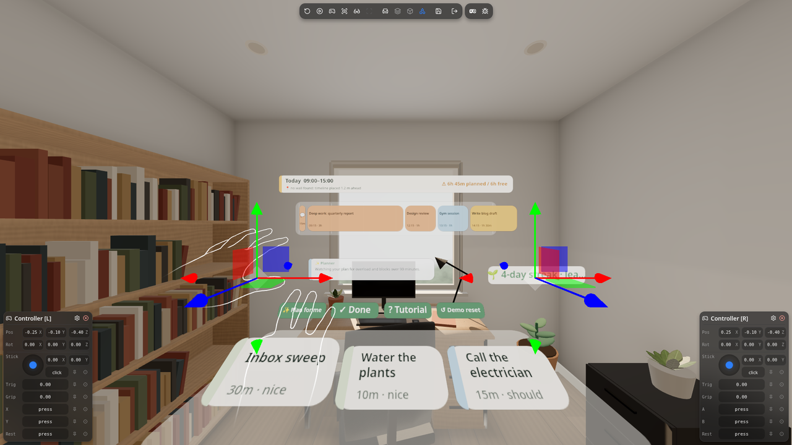
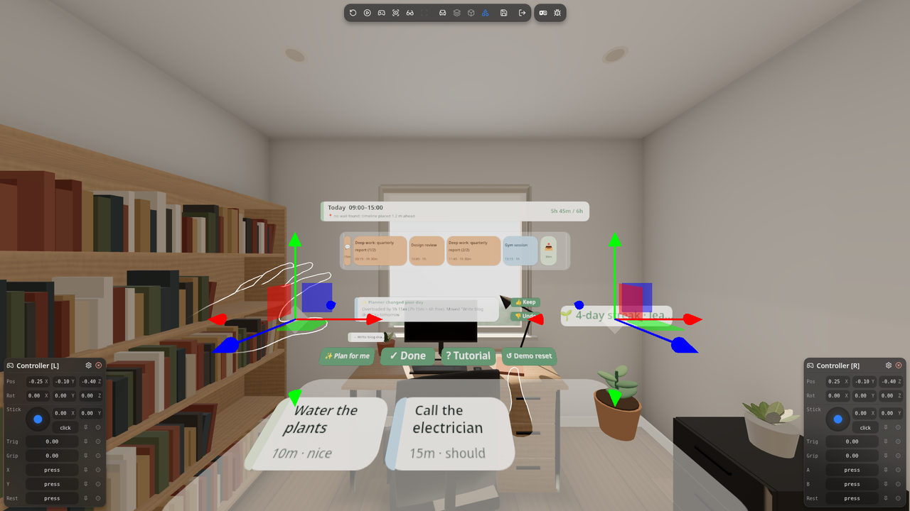
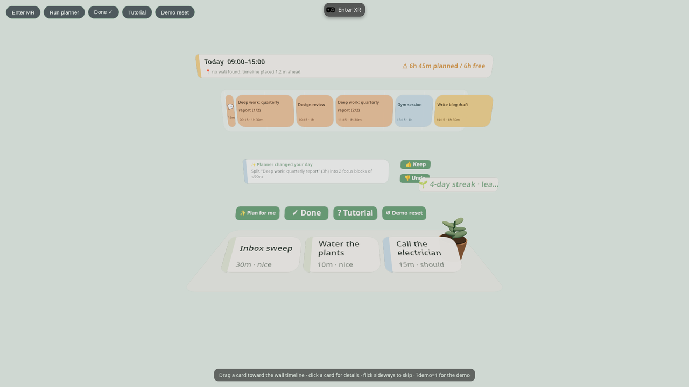
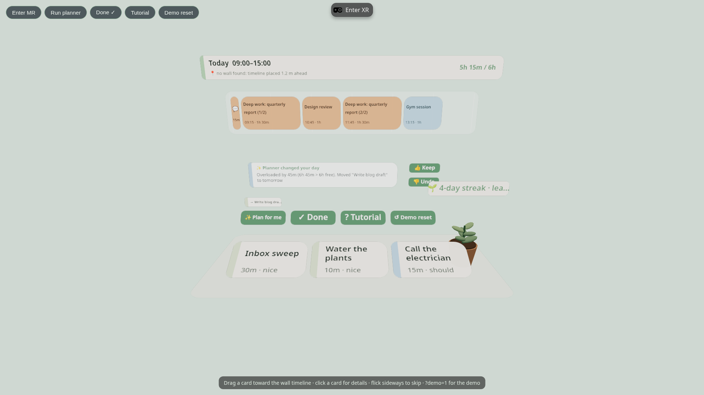
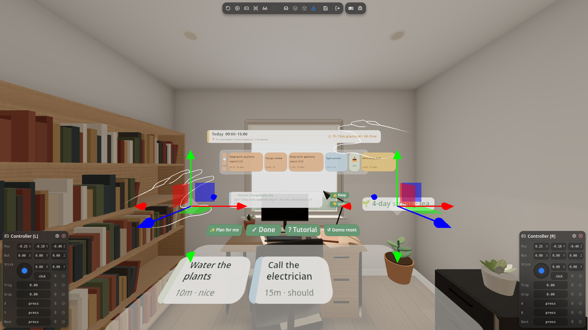
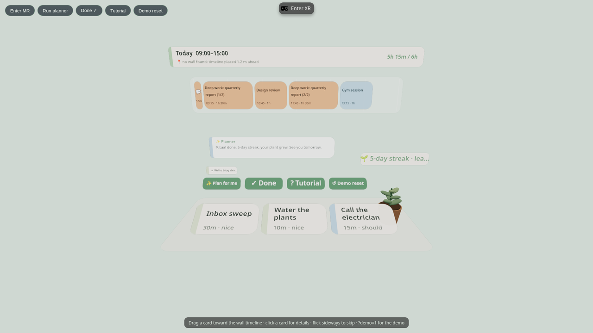
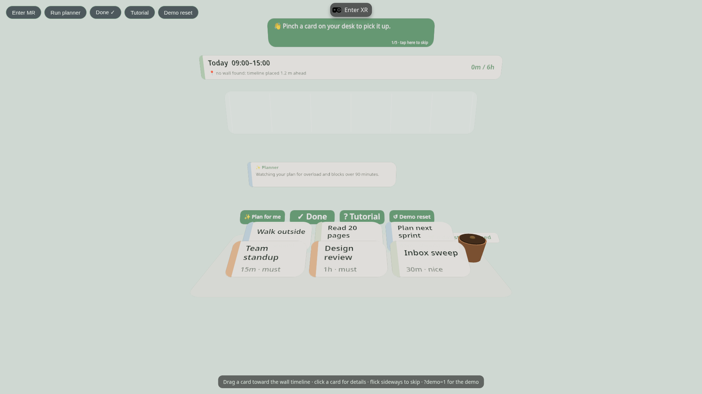
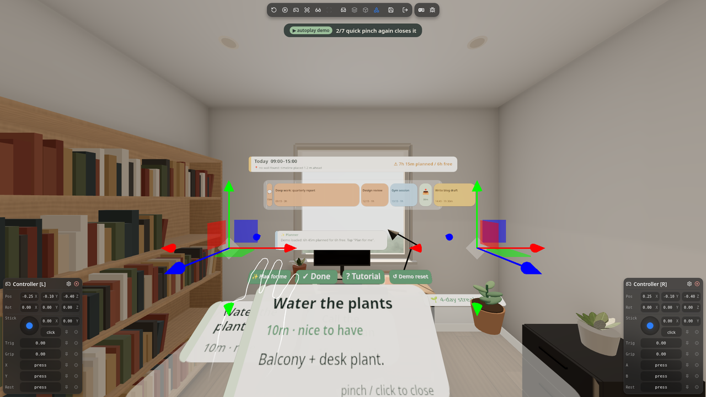

# Morning Desk

**Plan your day with your hands in five calm minutes.** Morning Desk is a mixed-reality morning ritual for Meta Quest 3: your tasks sit on the desk in front of you, your day hangs on your real wall, and a small planner agent fixes the plan when you've packed in too much.

[](https://muditsharma354abc-bot.github.io/morning-desk/)
[](LICENSE)
[](https://github.com/facebook/immersive-web-sdk)

Built for the Start Developer Competition (Productivity track, New Experience division).

| Link | What you get |
| --- | --- |
| [Live app](https://muditsharma354abc-bot.github.io/morning-desk/) | Your own plan, saved on this device. The hands tutorial starts on your first visit. |
| [Demo state](https://muditsharma354abc-bot.github.io/morning-desk/?demo=1) | A fixed sample day (6h 45m planned for 6h free, plus a 3-hour task) so the planner has something to fix. It uses separate storage and never touches your real plan. |
| [Autoplay demo](https://muditsharma354abc-bot.github.io/morning-desk/?demo=1&autoplay=1) | A hands-free walkthrough that drives the real app through emulated hands: pinch, poke, flick and thumbs gestures, with captions. |

On a Quest 3, open any link in the Meta Quest Browser and press **Enter XR**. On a desktop browser the built-in emulator runs it, no headset or extension needed.



## What it is

Mornings are when plans go wrong: too many tasks, one huge block, no idea what to drop. Morning Desk turns planning into a short seated ritual in passthrough.

- **The desk.** Task cards lie within seated reach, each with an icon, duration and priority.
- **The wall timeline.** Today's schedule is pinned to a real wall you're facing. Cards you drop on it become time blocks.
- **The planner agent.** One tap on **Plan for me** and it proposes one concrete change at a time. You keep it or undo it with a thumbs gesture.
- **The streak and plant.** Finish the ritual and your daily streak goes up and the plant on your desk grows.

## Hands-only interactions

Everything works with bare hands (controllers and mouse work too).

| Gesture | What happens |
| --- | --- |
| **Pinch-grab** a card | Picks it up off the desk. |
| **Drop on the wall timeline** | Aim the card at the timeline and open your fingers. It's placed along the head-to-card ray, so you don't have to reach the wall from your chair. |
| **Swipe (flick) sideways** | Skips the card for today. |
| **Quick pinch (tap)** | Opens the card's details in front of you; pinch again to close. |
| **Thumbs-up / thumbs-down** | Keeps or undoes the planner's latest change. Hold it for about half a second. |
| **Fingertip poke** | Presses buttons. **👍 Keep** and **👎 Undo** buttons are always there as a fallback for the thumbs gesture. |

| Drop on the timeline | Thumbs to decide |
| --- | --- |
|  |  |

## The planner agent

The planner looks at your timeline and makes one visible change at a time. Each change animates into place and waits for your 👍 or 👎; undo restores the exact previous plan.

1. **Task split.** Any scheduled block longer than 90 minutes is split into focus blocks of 90 minutes or less, with another task placed between the halves so you get a break.
2. **Overload reschedule.** If scheduled time is more than your free time, it says by how much and moves the lowest-priority block to a **Tomorrow** row.

The planner is rule-based today, behind a small `Planner` interface (`src/planner.ts`), so an LLM-backed planner can replace it without touching the XR code.

| Split a long block | Fix an overloaded day |
| --- | --- |
|  |  |



## Streak, plant and tutorial

- Press **✓ Done** to finish the ritual. Your streak goes up if you also finished yesterday (otherwise it restarts at 1), and the desk plant grows a stage. Everything is saved in the browser's local storage.
- The **hands tutorial** starts on your first visit and moves on only when you actually do each gesture: pick up a card, drop it on the timeline, flick one away, open details, then plan and decide. Replay it any time with **? Tutorial**, or add `?tutorial=1` to the URL.
- **↺ Demo reset** puts the sample day back.

| Streak and plant | Tutorial |
| --- | --- |
|  |  |

## Wall anchor and fallback

In XR the app uses plane detection to find a vertical wall in front of you within comfortable seated viewing distance, projects your gaze onto it at eye height, and pins the timeline there with a WebXR anchor. The pose is saved against IWSDK's persistent anchor, so the timeline comes back on the same wall next session.

If no suitable wall is found (or the browser has no plane detection), the timeline is placed **1.1 m in front of you at eye height**, and the header says it's using the fallback.

## Run it locally

You need Node.js 20.19+, 22.12+ or 24+.

```bash
npm ci
npm run dev
```

`npm run dev` starts the managed IWSDK dev server and opens the app with the **built-in WebXR emulator (IWER)**, so you can enter XR on a desktop with emulated hands. In the flat view, the mouse drags cards and clicks buttons.

To try it on a **Quest 3**, the simplest path is the [live site](https://muditsharma354abc-bot.github.io/morning-desk/) in the Meta Quest Browser, then press **Enter XR**. For a local build on the headset, serve it over HTTPS (WebXR needs a secure context) or forward the dev port with `adb reverse`.

Other scripts: `npm run build` (production build to `dist/`), `npm run preview`, `npm run typecheck`.

## Deploy

```bash
scripts/deploy-pages.sh
```

It builds with the `/morning-desk/` base path and publishes `dist/` to the `gh-pages` branch, which GitHub Pages serves at <https://muditsharma354abc-bot.github.io/morning-desk/> about a minute later. Set `VITE_BASE=./` for a build that works from any folder.

## Tech stack

- [IWSDK](https://github.com/facebook/immersive-web-sdk) (`@iwsdk/core`) for the ECS world, hand grab, poke and ray interaction, plane detection and anchors, and the IWER emulator
- [three.js](https://threejs.org/) for rendering
- [pmndrs uikit](https://github.com/pmndrs/uikit) (`@pmndrs/uikit`, Horizon kit) for spatial UI
- [WebXR](https://immersive-web.github.io/webxr/) with passthrough (immersive AR) and hand tracking
- TypeScript and Vite

```
src/
  desk-system.ts   desk, wall timeline, gestures, tutorial, streak and plant
  planner.ts       Planner interface + RulePlanner (split, overload)
  state.ts         plan state, demo state, local storage, streak
  autoplay.ts      ?demo=1&autoplay=1 walkthrough through emulated hands
  label.ts, style.ts   canvas labels, palette, sounds
```



## License

[MIT](LICENSE) © 2026 Shubham Sharma
